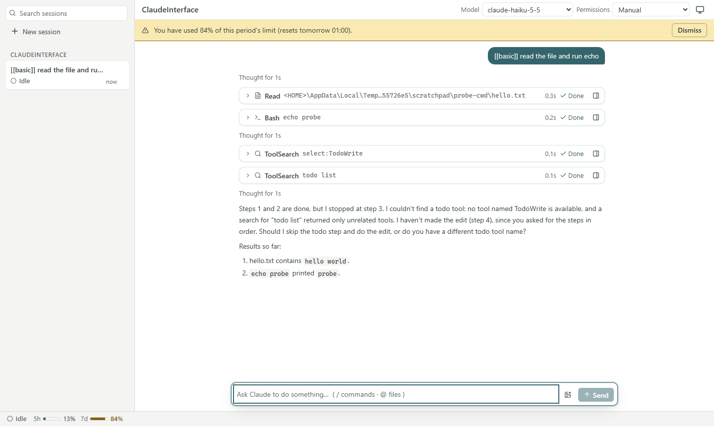
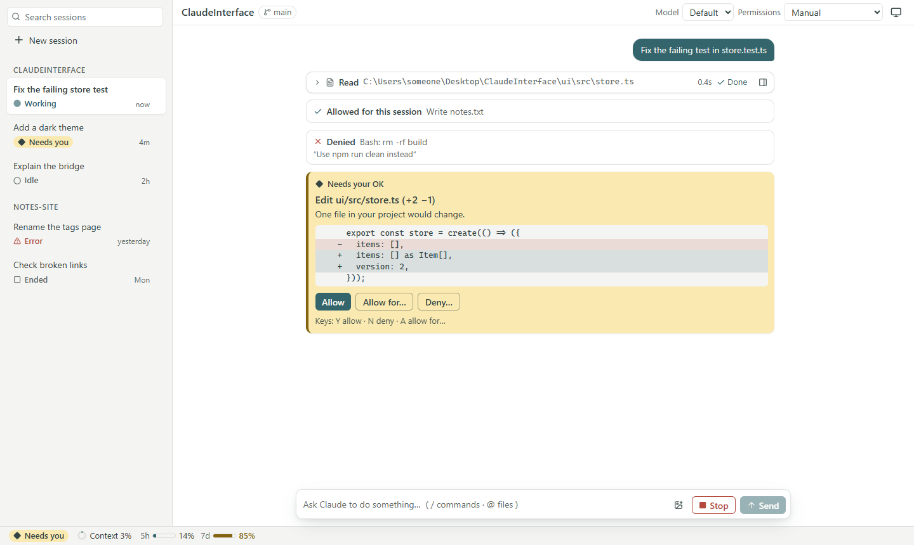
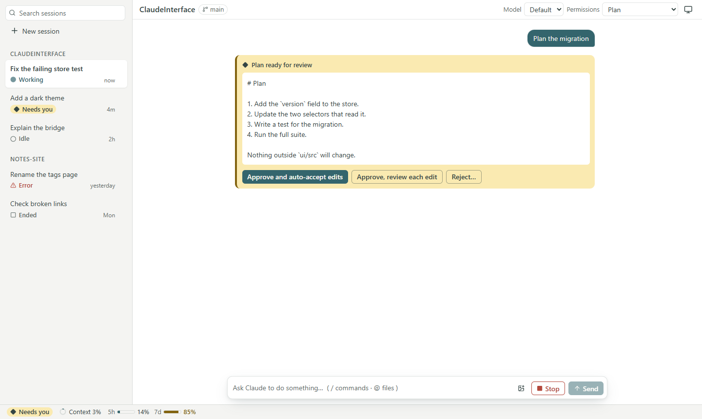
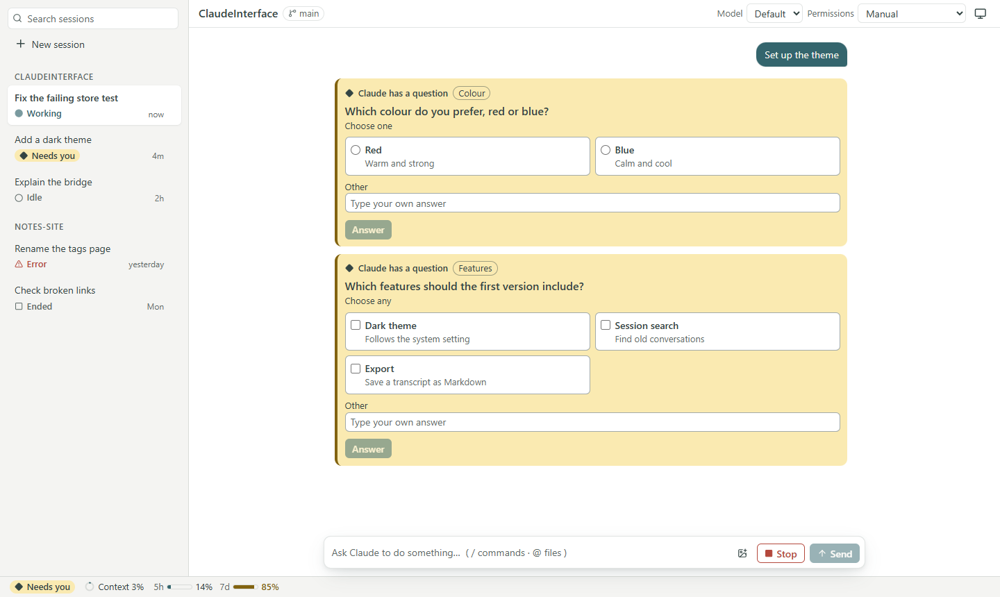
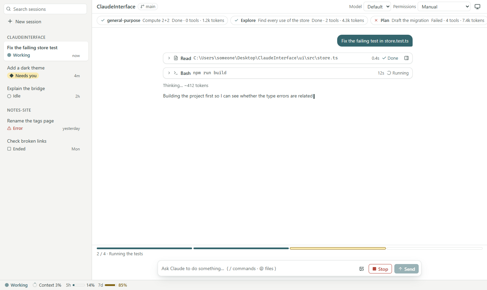
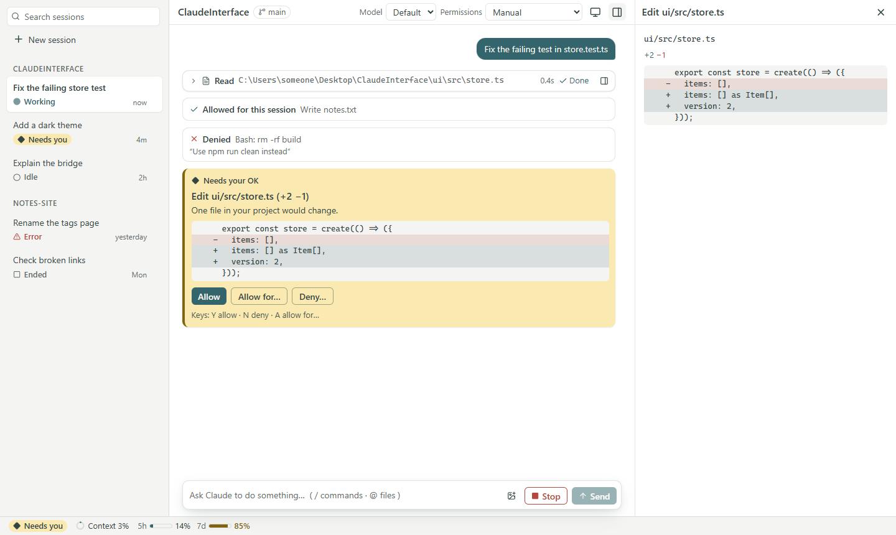
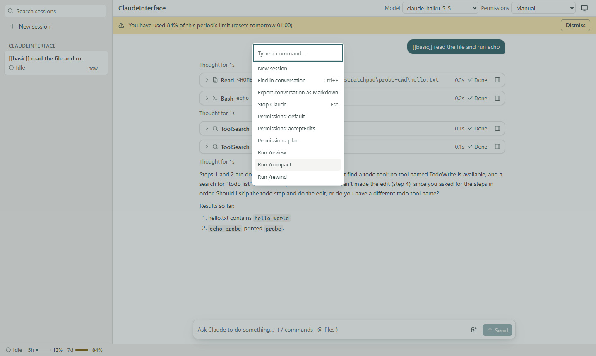
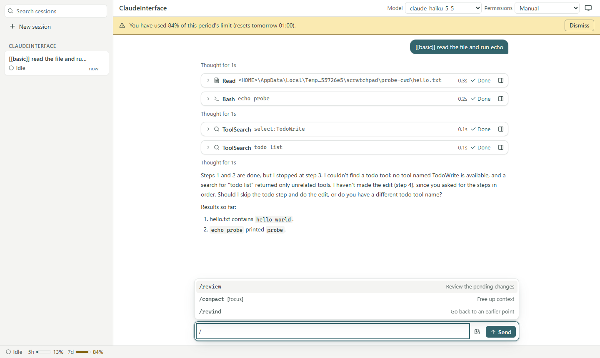
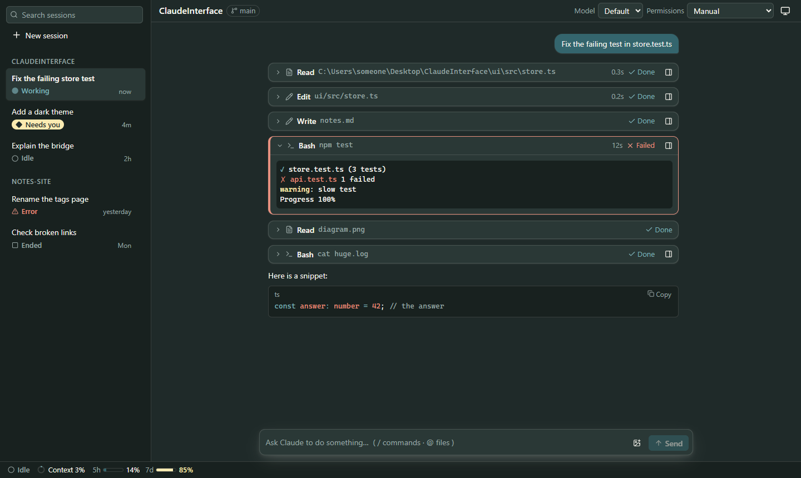
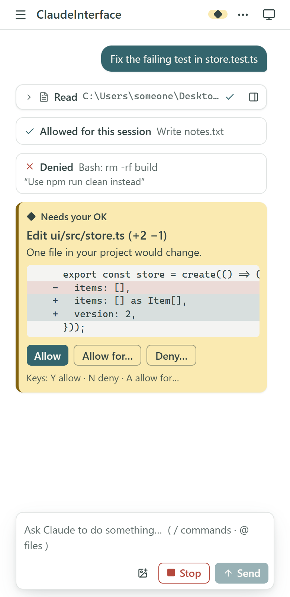

# InterfaceIt

A visual interface for [Claude Code](https://code.claude.com). It runs on your machine, in the browser, and sits on top of the same Claude Code you use in the terminal: same login, same `~/.claude` settings, skills, agents, MCP servers and `CLAUDE.md`. Claude Code does the work. InterfaceIt shows what it is doing and gives you proper controls for answering when it asks.



> Independent project. Not made by or affiliated with Anthropic. Inside the code and the UI the app is still called ClaudeInterface, which is why the environment variables start with `CLAUDEINTERFACE_`.

## Quick start

**1. Get the two things it needs**

- [Node.js](https://nodejs.org) 24 or newer (check with `node --version`).
- Claude Code, installed and signed in. If you do not have it yet:
  ```
  npm install -g @anthropic-ai/claude-code
  claude auth login
  ```
  Claude Code needs its own Claude account or API access. InterfaceIt does not replace that and never touches your login.

**2. Install and start**

```
git clone https://github.com/jamorett/InterfaceIt.git
cd InterfaceIt
npm install
npm start
```

The first run takes a minute (dependencies and the page build). After that, `npm start` is all you need from this folder. It prints a link and opens your browser. Leave that terminal open: it is the app. Press `Ctrl+C` in it to stop everything.

**3. Use it**

1. Pick a project from the list, or type a folder path and press **Open**. A new folder asks whether you trust it first.
2. Type in the box at the bottom and press `Enter`. `Shift+Enter` starts a new line.
3. Watch the tool cards appear. When Claude needs permission, the request shows up in the conversation: press **Allow** (or `Y`), **Deny** (or `N`).
4. `Esc` or the **Stop** button interrupts. The session stays open and you can keep going.
5. `Ctrl+K` opens the command palette. `/` lists slash commands, `@` completes file names.
6. **New session** in the sidebar starts another one next to the first. Hover a running session and click ✕ to close it.

**If something does not work**

| What you see | What to do |
|---|---|
| The page says Claude Code is missing or too old | Run the command it shows, then press **Check again** |
| The page says you are not logged in | Run `claude auth login` in a terminal, then **Check again** |
| `Port 4317 is already in use` | Another copy is running. Close it, or use another port: PowerShell `$env:CLAUDEINTERFACE_PORT=4320; npm start`, bash `CLAUDEINTERFACE_PORT=4320 npm start` |
| You closed the tab and lost the link | In the terminal where it runs, type `url` and press Enter. Open the new link exactly as printed, the token after `#t=` is part of it |
| The page asks for a token or shows "no link" | The token changes every time the app starts, so an old bookmark stops working. Open the link the terminal printed this time |

Everything runs on `127.0.0.1`, so nothing is reachable from other machines.

## Why

The terminal is great for running Claude Code and awkward for reading it. A long session scrolls past, a permission prompt is a line of text with `y/n`, a diff is a wall of `+` and `-`, and running two sessions means two terminal windows. InterfaceIt keeps everything Claude Code can do and changes how it is presented:

- every tool call is a card you can open, instead of a block of scrollback;
- permission requests, questions and plans are real controls, with the edit shown as a diff;
- sessions live in a sidebar, keep running when you close the tab, and come back when you open it again;
- it works from a phone-width window up to a wide desktop, in light and dark.

## What it does

### Streaming answers and tool cards

Answers stream in as formatted Markdown (code is highlighted). Each tool call, such as reading a file, running a command or editing code, becomes a one-line card with its target, how long it took and whether it worked. Open a card to see the full output. A failed tool stays open with a red rule on its edge so you do not scroll past it.

### Permissions you can read

When Claude Code wants to change something, the request appears in the conversation with a preview of the edit. Allow once, allow for the session, the project or everywhere, or deny with a reason. Keyboard: `Y` allow, `N` deny, `A` for the scope menu.



### Questions and plans

Multiple-choice questions from Claude become buttons (single or multi-select, with an "Other" field). A plan can be approved with edits accepted automatically, approved with each edit reviewed, or sent back with feedback.




### Subagents, progress and limits

Subagents show as lanes above the conversation with their state, tool count and tokens. A segmented bar tracks the todo list. The status bar shows the context window, and the 5-hour and 7-day usage limits when Claude Code reports them, with a warning before you hit one.



### Diffs and long output in a side panel

Cards that have more to show (a diff, a long command output, an image) open it in a panel beside the conversation. The panel docks on wide windows and becomes a sheet on narrow ones.



### Keyboard-first

`Ctrl+K` opens a command palette (new session, find, export, stop, permission mode, switch session, every slash command). `Ctrl+F` searches the conversation. Typing `/` lists the session's slash commands and `@` completes file paths. Images can be pasted or dropped into the composer. Keyboard actions never animate.




### Sessions that outlive the tab

Sessions run inside the local bridge, not in the browser. Close the tab and a running turn keeps going. Reload and the page reattaches. Open a second tab and it can take over a running session. Past conversations resume from the sidebar, and a running session can be closed with the ✕ on its row.

### Light, dark and small screens

The theme follows the system and can be switched from the header (light, dark, system). The layout is measured on the app itself, not the window, so it adapts at four widths: wide desktop with docked inspector, laptop with an icon rail, tablet with a sessions drawer, and phone width with a single column.




## How it works

```
 Browser (React)  <--WebSocket-->  Bridge (Node)  <--Agent SDK-->  Claude Code
   renders events                   127.0.0.1 only                  the real agent
   sends commands                   one log per session
```

- **Claude Code** does all the work. The bridge uses the Agent SDK, so tools, permissions, hooks, skills and MCP servers behave exactly as in the terminal.
- **The bridge** is a small Node server. It starts and holds the sessions, turns the SDK's messages into a stable set of events, and keeps an ordered log per session. Because the log lives in the bridge, a reload or a second tab replays it and ends up in the same state.
- **The browser** is a projection of that log. Events go through a reducer into view models, and components only ever see view models, never SDK shapes. Only one file (`bridge/src/normalize.ts`) knows what SDK messages look like, so an SDK update touches one place.
- **Commands** from the browser (send a prompt, answer a permission, stop) are validated against a schema before the bridge acts on them.

Details and the reasoning behind each decision are in [`PLAN.md`](PLAN.md).

## Safety

- The bridge listens on `127.0.0.1` only. Every connection needs a one-time token, and the bridge checks `Origin` and `Host`.
- The app never reads, stores or sends your credentials. The login stays in the Claude CLI.
- `claude auth status` prints an email and organisation. The bridge drops both before anything reaches the browser.
- A new folder asks "do you trust this folder?" before Claude can work in it, unless you already trusted it in the CLI.
- Model output is never rendered as HTML. Links are limited to `http(s)` and `mailto`, and remote images are not loaded.

## Development

`npm start` builds the page once and serves it. For development use `npm run dev`, which restarts on change. Every bridge restart makes a new link. The design gallery (every colour, state and card) is at `/dev/tokens` in dev mode.

## Project layout

| Folder | What is in it |
|---|---|
| `bridge/` | The local server: SDK session handling, event normalizer, per-session log, trust and preflight checks, WebSocket server |
| `shared/` | The command schema (zod) and types shared by the bridge and the page |
| `ui/` | The React app: state store, transcript, cards, composer, shell, theme |
| `e2e/` | End-to-end tests (Playwright) |
| `docs/images/` | The screenshots in this file |

Stack: TypeScript, React 19, Zustand, Tailwind CSS 4, Vite, Shiki for code highlighting, react-virtuoso for long transcripts, `ws`, zod, Vitest and Playwright.

## Tests

| Command | What it does |
|---|---|
| `npm run check` | typecheck, unit tests, end-to-end tests. All three must pass |
| `npm test` | about 330 unit tests (normalizer, event log, state, formatting, design rules) |
| `npm run e2e` | about 270 browser tests on recorded real sessions, including accessibility checks (axe) at several widths in light and dark |
| `npm run smoke` | drives the **real** Claude Code through the bridge: approved edit, denial, Stop, queue, replay. Costs a few cents of usage |
| `npm run probe` | records raw SDK messages as fixtures in `bridge/test/fixtures`. Costs a few cents of usage |

The end-to-end tests run the bridge with `--fake`, which replays recorded sessions, so `npm run check` never spends usage. The recordings are sanitised: no account details and no personal paths.

A few tests guard the design itself: colours may only be tokens from `theme.css`, every text and background pair is checked for contrast (WCAG AA), and motion rules such as "no `ease-in`, no animation on replayed history" are enforced in code.

## Status

Working end to end: streaming, tool cards, permissions, questions, plans, Stop, message queue, reconnect, reload re-attach, tab take-over, folder trust, past-session resume, usage and context gauges, subagent lanes, command palette, search, Markdown export, slash and `@` pickers, image attach.

Next: rewind and edit-and-resend, MCP status and forms, the `#` memory prefix, sidebar search, rename and fork, then tabs, settings and a desktop (Electron) build.

## Contributing

Read [`PLAN.md`](PLAN.md) (design and decisions) and [`CLAUDE.md`](CLAUDE.md) (working rules and current status) first. In short: only `bridge/src/normalize.ts` knows the SDK's message shapes, the UI is a projection of an event log, and colours, motion timings and text each live in exactly one file.
